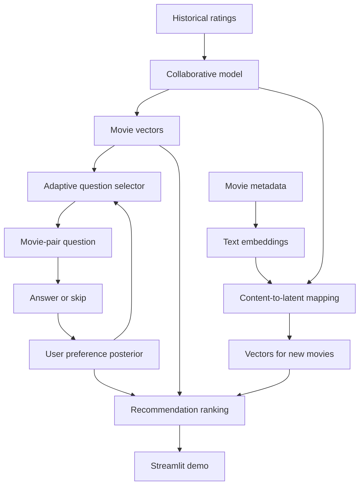

# Adaptive Taste

**A cold-start movie recommender that learns user preferences through information-driven questions.**

Adaptive Taste explores whether choosing onboarding questions adaptively can produce good recommendations with fewer answers than a fixed questionnaire, particularly for users whose tastes differ from mainstream preferences.

**Status:** Project design and implementation roadmap, with Track C's initial scaffolding in place (data split, fixed-baseline question builder, evaluation metrics, FastAPI service, Streamlit demo) running against mock Track A/B placeholders. See [Getting started](#getting-started) below. Real collaborative vectors (Track A) and Bayesian active learning (Track B) are not implemented yet.

## Getting started

Track C's scaffolding (data splits, fixed baseline, evaluation harness, API, demo) is runnable today against **mock** Track A vectors and a mock Track B user model (see `src/core/mock_vectors.py` and `src/active_learning/mock_model.py`). Numbers produced this way are not meaningful recommendations -- they only exercise the pipeline end to end until the real collaborative model and active-learning engine land.

```bash
python -m venv .venv
.venv\Scripts\activate          # Windows; use `source .venv/bin/activate` on macOS/Linux
pip install -r requirements.txt

# Download MovieLens (ml-latest-small, configured in configs/data.yaml)
python -m src.data.download

# Build the shared user cold-start split (core-train / onboarding-pool / hidden-test)
python -m src.data.splits

# Run the fixed-vs-adaptive onboarding comparison (writes reports/onboarding_comparison.csv)
python -m src.evaluation.run_comparison

# Run the test suite
pytest tests/ -q

# Serve the API, then the demo in a second terminal
uvicorn src.api.main:app --reload
streamlit run demo/app.py
```

## The problem

A new user has no interaction history, so a recommendation system has little evidence about their preferences. This is the **user cold-start problem**.

A common onboarding approach asks everyone to select from the same popular items. These questions can be useful, but may provide limited information for users with unusual tastes.

Adaptive Taste asks a different question:

> Given this user's previous answers, which movie comparison would reduce our uncertainty about their preferences the most?

The project also addresses **item cold start**: representing a new movie before it has accumulated ratings.

## What we are building

A movie recommendation demo with two onboarding modes:

- **Fixed onboarding:** a predetermined sequence of movie-pair questions.
- **Adaptive onboarding:** the next pair is selected using expected information gain.

Users choose between two movies or skip a question when they cannot answer. Their answers update an estimated taste profile, which is used to rank movies.

The demo will show two users receiving different question sequences as their answers diverge. Before any answers, users with the same prior may receive the same first question.

The experimental goal is to compare recommendation quality against the number of questions asked. Improvements are a hypothesis to test, not an assumed outcome.

## How it works

### Offline training

1. Prepare historical movie ratings and metadata using an agreed training split.
2. Train a matrix-factorization model to learn user and movie vectors.
3. Encode movie metadata with a sentence-transformer.
4. Train a mapping from content embeddings into the collaborative movie-vector space.
5. Export versioned vectors, ID mappings, model configuration, and the content mapping.

### Online onboarding

1. Initialize a probability distribution over a new user's possible preference vectors.
2. Score candidate movie pairs by how much an answer is expected to reduce uncertainty.
3. Ask the highest-scoring eligible question.
4. Update the user's posterior after their answer; handle skips separately.
5. Rank movies using the current preference estimate.
6. Repeat until the user stops or the question budget is reached.

The shared movie model stays fixed during a session. A user's answers update their session preference estimate rather than retraining the entire model.



## Core concepts

| Concept | Meaning in this project |
| --- | --- |
| Collaborative filtering | Learn taste patterns from historical user–movie interactions. |
| Latent vector | A learned numerical representation of a user or movie. Its dimensions are not necessarily named genres. |
| Matrix factorization | Learn compact user and movie representations from a sparse interaction matrix. |
| Prior | A distribution describing possible user preferences before onboarding answers. |
| Posterior | The updated distribution after incorporating answers. |
| Expected information gain | Expected reduction in uncertainty after asking a question. |
| BALD | Bayesian Active Learning by Disagreement; a mutual-information criterion for selecting informative questions. |
| Content embedding | A numerical representation of item text or metadata. |

### Recommendation scoring

For an initial model without item biases, the score for user vector `p` and movie vector `q_i` is:

```text
score(p, i) = dot(p, q_i)
```

Higher scores rank earlier. Scores are not automatically probabilities or predicted star ratings.

### Pairwise preference modeling

A possible answer model for Track B is:

```text
P(choose A | p) = sigmoid(dot(p, q_A - q_B) / temperature)
```

This is a proposed likelihood, not an implemented or calibrated model. Track B will choose the inference method and calibrate the response model on validation data.

### Information-driven question selection

```text
EIG(pair) = current posterior entropy
            - expected posterior entropy after the answer
```

The expectation considers possible answers and their predicted probabilities. BALD can be estimated from posterior samples using predictive entropy minus average conditional entropy.

Selecting an informative question is different from selecting a movie the user is most likely to enjoy. The best question helps distinguish plausible taste profiles.

## Team responsibilities

| Track | Owner | Responsibilities | Main handoff |
| --- | --- | --- | --- |
| A. Recommendation Core | Person 1 | Data preparation for model training, matrix factorization, movie vectors, ranking, content embeddings, and item cold-start mapping | Versioned model artifacts and a ranking interface |
| B. Active Learning Engine | Person 2 | User prior and posterior, answer likelihood, inference, candidate-pair selection, and expected-information-gain/BALD estimation | Session preference state and adaptive questions |
| C. Evaluation and Deployment | Person 3 | Shared data splits, fixed baseline, niche subset, evaluation harness, FastAPI, Streamlit, Docker, and Cloud Run integration | Reproducible experiments and a working application |

Track A can start immediately. Track B can initially use mock movie vectors. Track C can develop the data split, baseline, and evaluation harness before full integration.

### Track A: Person 1 deliverables

- Reproducible preprocessing using the agreed training split.
- A trained collaborative model with an agreed vector dimension.
- Movie vectors and stable movie-ID-to-row mappings.
- A function that ranks eligible movies for a supplied user vector.
- A metadata encoder and a trained content-to-latent mapping.
- Training-user vectors or summary statistics to support Track B's prior design.
- Saved artifacts with matching model versions and configuration.
- Validation of ranking behavior and performance on held-out cold items.

Suggested implementation order: collaborative model → ranking → handoff to Track B → content mapping → cold-item validation → packaging.

## Planned technology stack

| Component | Initial approach |
| --- | --- |
| Language | Python |
| Data preparation | pandas, NumPy, SciPy sparse matrices |
| Collaborative model | ALS through `implicit`; BPR or LightFM are alternatives |
| Content embeddings | `sentence-transformers` |
| Content-to-latent mapping | Regularized linear regression as an initial baseline |
| Active learning | Bayesian preference inference with approximate posterior sampling |
| API | FastAPI |
| Demo | Streamlit |
| Packaging | Docker |
| Deployment | Google Cloud Run |

The team will start with one collaborative model rather than implement every alternative.

## Dataset and preprocessing

The initial development dataset is MovieLens. A stable benchmark release should be selected for final reported experiments.

Useful fields include:

```text
ratings: user_id, movie_id, rating, timestamp
movies:  movie_id, title, genres
```

MovieLens provides titles, genres, and user tags; plot summaries require a separate source. User-generated tags must be restricted to information available under the chosen split and cold-start scenario.

If using implicit ALS, explicitly convert star ratings into positive interactions and confidence weights. For example, ratings of 4 or above may count as positives. Missing ratings mean unknown preferences, not explicit dislike.

For item cold start, encode metadata and learn a mapping into the collaborative space. Text embeddings cannot be used interchangeably with collaborative vectors without alignment.

Data download instructions, release checksums, and preprocessing commands will be added with the implementation. Follow the selected dataset's usage terms and attribution requirements.

## Shared interface contract

Proposed Track A interfaces:

```python
get_item_vector(movie_id: int) -> ndarray

recommend(
    user_vector: ndarray,
    k: int = 10,
    exclude_ids: set[int] | None = None,
) -> list[Recommendation]

embed_new_item(metadata: dict) -> ndarray
```

Proposed Track B interfaces:

```python
initialize_user() -> PosteriorState

select_next_pair(state: PosteriorState, candidate_ids: list[int]) -> ItemPair

update_user(state: PosteriorState, answer: PairwiseAnswer) -> PosteriorState
```

These signatures describe the intended contract; they are not available functions yet.

Before integration, agree on vector dimensions, score biases, answer values, skip behavior, exclusion rules, and artifact versions. A pairwise answer should identify the session, both movies, and the choice: A, B, or skip.

## Evaluation plan

### Fair baseline comparison

Compare fixed and adaptive question selection using the same movie vectors, posterior-update method, recommendation scorer, candidate eligibility rules, and question budget. The baseline sequence must be constructed from training data without access to evaluation-user answers.

### Metrics

| Metric | Purpose |
| --- | --- |
| NDCG@k | Measure whether relevant movies appear near the top, with optional graded relevance. |
| MAP@k | Measure ranking quality using a defined binary relevance threshold. |
| Questions needed to reach target | Measure how quickly onboarding reaches a predefined quality threshold. |
| Quality versus question count | Show the full tradeoff between user effort and recommendation quality. |
| Target-reached rate | Report how many users reach the target within the maximum budget. |

Define the convergence target before comparing methods. One option is a chosen fraction of a reference score obtained from additional onboarding-history ratings, without revealing final test ratings.

Report users who never reach the target, uncertainty across users or seeds, and skips separately from informative answers.

### User cold-start protocol

1. Separate core-training users from evaluation users.
2. Split each evaluation user's ratings into an onboarding answer pool and a hidden recommendation test set.
3. Simulate pairwise answers only when the required ratings are available.
4. Define how ties and unavailable answers are handled.
5. Evaluate rankings after each onboarding step on the untouched test set.

MovieLens does not provide direct answers to arbitrary pairwise questions. Comparisons inferred from ratings are an offline approximation and must be described as such.

### Niche-taste subset

Define the subset before measuring outcomes. A candidate criterion is disagreement with rating consensus on popular movies, requiring enough observations for a meaningful estimate.

Compute popularity and consensus from core-training data. Use a separate evaluation-user history portion for subset membership rather than the final recommendation test set. Report results for all users and the niche subset.

### Item cold-start protocol

Hold out selected movies' interactions from collaborative training. Use only permitted metadata to estimate their vectors, then evaluate ranking quality using held-out interactions. Keep this experiment separate from the main onboarding comparison.

## Repository structure

```text
.
├── README.md
├── configs/                 # Training and evaluation settings (data.yaml, eval.yaml)
├── data/                    # Local data; follow dataset distribution terms (gitignored)
├── artifacts/               # Versioned trained outputs
├── src/
│   ├── data/                # Loading, preprocessing, and shared splits
│   ├── core/                # Track A: vectors and ranking (mock_vectors.py until trained)
│   ├── content/             # Track A: embeddings and cold-item mapping (not yet implemented)
│   ├── active_learning/     # Track B: posterior and question selection (mock_model.py until trained)
│   ├── evaluation/          # Track C: baseline, metrics, and comparison harness
│   └── api/                 # Track C: FastAPI integration
├── demo/                    # Track C: Streamlit interface
├── tests/                   # Model, inference, and integration checks
├── reports/                 # Experimental results and figures
└── Dockerfile
```

This layout matches the originally proposed structure. `src/core` and `src/active_learning` currently hold mock implementations behind the shared interfaces (`src/core/interfaces.py`, `src/active_learning/interfaces.py`) so Track C's harness, API, and demo work end to end; `src/content` is still empty pending Track A's content embeddings and cold-item mapping.

## Roadmap

- [ ] Agree on the dataset release, split protocol, and shared interfaces.
- [ ] Train and validate the collaborative recommendation core.
- [ ] Export versioned movie vectors and ID mappings.
- [ ] Implement the fixed-question baseline.
- [ ] Implement Bayesian user preference updates.
- [ ] Implement information-driven pair selection.
- [ ] Train and evaluate the content-to-latent mapping.
- [ ] Run overall and niche-subset experiments.
- [ ] Build the Streamlit comparison demo and FastAPI service.
- [ ] Package with Docker and deploy to Cloud Run.
- [ ] Publish reproducible results, setup instructions, and limitations.

## References

- [MovieLens datasets — GroupLens](https://grouplens.org/datasets/movielens/)
- [MovieLens small dataset README](https://files.grouplens.org/datasets/movielens/ml-latest-small-README.html)
- [`implicit` documentation](https://benfred.github.io/implicit/)
- [LightFM item cold-start example](https://making.lyst.com/lightfm/docs/examples/hybrid_crossvalidated.html)
- [Sentence Transformers usage](https://sbert.net/docs/sentence_transformer/usage/usage.html)
- [Bayesian Active Learning for Classification and Preference Learning](https://arxiv.org/abs/1112.5745)
