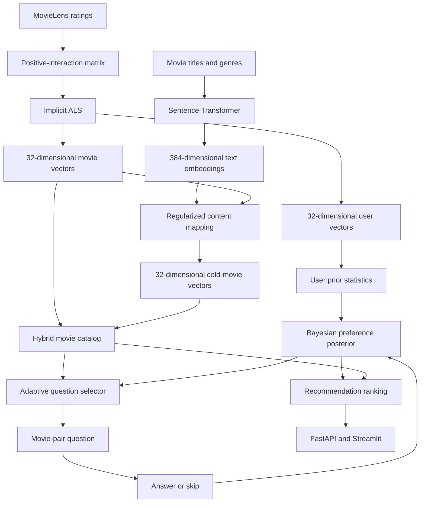

# Adaptive Taste

**An information-driven cold-start movie recommender that learns a new user’s preferences through adaptive questions.**

Adaptive Taste investigates whether selecting onboarding questions according to their expected information value can produce useful recommendations with fewer answers than a fixed, popular-movie questionnaire.

The system combines:

- Collaborative filtering using implicit-feedback ALS
- Transformer-based movie metadata embeddings
- Content-based handling of unseen movies
- Bayesian user-preference estimation
- Adaptive movie-pair question selection
- Fixed-versus-adaptive onboarding evaluation
- A FastAPI backend and Streamlit demonstration interface

## Project status

| Track | Status |
| --- | --- |
| Track A — Recommendation Core | **Implementation and item cold-start evaluation complete** |
| Track B — Active Learning Engine | **Bayesian inference, BALD selection, and temperature calibration complete** |
| Track C — Evaluation and Deployment | **Real-model wiring and comparison complete; container packaging/deployment pending** |

Track A currently provides a tested recommendation core with:

- A trained 32-dimensional ALS latent space
- User and movie vectors
- Recommendation ranking by dot product
- Prior mean and covariance for user-preference initialization
- Sentence Transformer movie embeddings
- A trained content-to-ALS mapping
- Hybrid support for all 9,742 MovieLens catalog movies
- A leakage-controlled item cold-start experiment
- Versioned and checksum-verified artifacts

The API and comparison runner select the real hybrid core and Bayesian user model when `mock_vectors.enabled` is false. The real-model onboarding evaluation is complete; its sparse simulated answers show that more work is needed before drawing conclusions about adaptive question quality. Container packaging and deployment remain.

## Project summary

Adaptive Taste is a MovieLens-based prototype for cold-start recommendations. It combines a collaborative model with movie metadata and compares a fixed onboarding questionnaire against one that chooses each movie pair based on the current user's estimated preferences.

### How the system works

1. **Prepare the data.** MovieLens ratings are split into core-training users and held-out evaluation users. Positive interactions train the collaborative model; held-out evaluation users' ratings are reserved for simulating onboarding answers and measuring recommendation quality.
2. **Build the shared item space (Track A).** A 32-factor implicit ALS model learns user and supported-movie vectors. A MiniLM encoder turns titles and genres into normalized 384-dimensional embeddings; a ridge mapping projects those into the ALS space for unsupported catalog movies. The hybrid catalog contains 9,742 movies: 5,862 with ALS vectors and 3,880 with content-predicted vectors.
3. **Learn from onboarding answers (Track B).** The Bayesian pairwise model initializes from the training users' empirical prior statistics, updates a Gaussian approximation after each A/B answer, and ranks movies using its posterior mean. Monte Carlo BALD scores choose adaptive questions. A skip contributes no update.
4. **Compare and serve (Track C).** A farthest-point fixed sequence is compared with adaptive question selection using the same model-update method and question budget. The API exposes session and recommendation endpoints, and the Streamlit demo uses that API. `mock_vectors.enabled` in `configs/eval.yaml` switches between mock and real core/model wiring; the checked-in configuration selects the real implementation.

### Current verified state

- Tracks A and B are implemented and connected to Track C's comparison and API paths.
- Rebuilt versioned model artifacts load and pass hybrid-core checks, including a finite 32-dimensional vector for a new movie.
- The held-out item cold-start test used 586 cold candidate movies and 442 eligible users. Transformer mapping reached NDCG@10 **0.1376**, versus **0.0642** for genre-only and **0.0184** for random ranking.
- The real onboarding comparison ran for five seeds over 122 users, including 18 in the niche subset. It completed, but averaged about **9.9 skips per 10 questions**. Fixed and adaptive recommendation quality was nearly unchanged, so this run verifies integration and measurement—not an adaptive advantage.
- The local API start/answer/recommend flow was smoke-tested against the real artifacts. The full test suite passed: **131 tests and 37 subtests**.

The trained artifacts and generated data are local, ignored by Git, and must be regenerated or shared on another machine. Docker/Podman and the Google Cloud CLI are unavailable in the current environment, so the container image and Cloud Run deployment have not been verified. Deployment also requires a configured, authorized cloud project.

## The problem

A new user has no interaction history, so the recommendation system initially knows very little about their preferences. This is the **user cold-start problem**.

Many applications handle this by showing every new user the same popular movies. That approach can work for mainstream users but may collect little useful information from users with niche or unusual tastes.

Adaptive Taste instead asks:

> Given this user’s previous answers, which movie comparison is expected to reduce uncertainty about their preferences the most?

The project also handles **item cold-start**. When a movie has no ratings, its title and genres are converted into a vector compatible with the collaborative recommendation model.

## What we are building

The application compares two onboarding strategies:

1. **Fixed onboarding**  
   Every user receives a predetermined sequence of popular movie questions.

2. **Adaptive onboarding**  
   Each question is selected from the current uncertainty about that specific user’s preference vector.

A user chooses between two movies or skips the question. Each answer updates the estimated preference distribution, which is then used to rank movies.

The onboarding evaluation reports:

- Recommendation quality after each question
- Questions needed to reach a target recommendation quality
- Percentage of users who reach the target
- Performance for users with niche tastes
- Performance of fixed versus adaptive onboarding

## System architecture



## Track A: Recommendation Core

Track A is responsible for learning the shared movie space used by the active-learning and evaluation components.

### Implemented pipeline

```text
MovieLens ratings
        ↓
Rating validation and user separation
        ↓
Positive interactions: rating >= 4.0
        ↓
Train/validation interaction split
        ↓
ALS model comparison
        ↓
Select positive-only ALS with 32 factors
        ↓
Refit using all approved core-training interactions
        ↓
Final user and movie vectors
```

The item cold-start pipeline is:

```text
Movie title + genres
        ↓
all-MiniLM-L6-v2 Sentence Transformer
        ↓
384-dimensional normalized text embedding
        ↓
Ridge regression mapping
        ↓
32-dimensional ALS-compatible movie vector
```

### Final collaborative model

The selected model uses:

| Setting | Value |
| --- | --- |
| Algorithm | Implicit-feedback ALS |
| Interaction rule | Rating greater than or equal to 4.0 |
| Latent dimensions | 32 |
| Positive confidence | 40.0 |
| Regularization | 0.01 |
| Training iterations | 20 |
| Random seed | 42 |
| Execution | CPU |
| Core-training users | 488 |
| Final positive interactions | 39,714 |
| Movies with positive collaborative support | 5,862 |

Ratings below the positive threshold are not automatically treated as dislikes in the selected model. A missing rating means an unknown preference.

A signed-interaction variation was also evaluated, but the positive-only model performed better in the selected validation experiment.

### Recommendation score

For user vector \(p_u\) and movie vector \(q_i\):

```text
score(u, i) = dot(p_u, q_i)
```

The score is used for ranking. It is not a probability or a predicted star rating.

### Final hybrid catalog

| Vector source | Movies |
| --- | ---: |
| Learned ALS vectors | 5,862 |
| Content-predicted vectors | 3,880 |
| Total scorable movies | **9,742** |

The hybrid core preserves learned ALS vectors whenever collaborative support exists. It uses metadata-derived vectors for movies without positive training support.

It can also encode a completely new movie from metadata:

```python
new_movie_vector = core.embed_new_item({
    "title": "The Last Signal (2026)",
    "genres": ["Sci-Fi", "Thriller"],
})
```

The returned vector has shape `(32,)` and can be scored against a compatible user-preference vector.

## Dataset and splitting

The development dataset is [MovieLens latest-small](https://grouplens.org/datasets/movielens/latest/).

It contains:

| File | Purpose |
| --- | --- |
| `ratings.csv` | User, movie, rating, and timestamp |
| `movies.csv` | Movie title and genres |
| `tags.csv` | User-generated movie tags |
| `links.csv` | IMDb and TMDb identifiers |

The shared user split separates:

- **Core-training users:** used for collaborative model training
- **Evaluation users:** reserved for the onboarding experiment

Track A verifies that evaluation-user ratings do not enter collaborative training.

The raw dataset, processed matrices, and trained model artifacts are ignored by Git because they are generated locally and may be large.

## Collaborative-model results

The selected 32-dimensional positive-only ALS model was evaluated against a popularity baseline using held-out positive interactions.

| k | ALS NDCG@k | Popularity NDCG@k | ALS MAP@k | Popularity MAP@k |
| ---: | ---: | ---: | ---: | ---: |
| 5 | **0.2148** | 0.1892 | **0.1369** | 0.1308 |
| 10 | **0.2148** | 0.1819 | **0.1188** | 0.1075 |
| 20 | **0.2384** | 0.1849 | **0.1188** | 0.0936 |

At `k=10`, the selected ALS model improved NDCG by approximately **18.1% relative to the popularity baseline**.

These values are ranking metrics, not classification accuracy percentages.

## Item cold-start evaluation

A separate leakage-controlled experiment evaluated movies whose interactions were entirely removed from ALS training.

### Experimental split

The 5,862 positively supported movies were divided by movie identity:

| Group | Movies | Positive interactions |
| --- | ---: | ---: |
| Warm ALS training | 4,690 | 31,637 |
| Cold validation | 586 | 4,216 |
| Cold test | 586 | 3,861 |

Every interaction belonging to a cold validation or cold test movie was excluded from experimental ALS training.

There were:

- 461 eligible validation users
- 442 eligible test users
- Zero cold-movie interactions in warm ALS training

A user qualified when they had at least one warm positive interaction and at least one positive interaction in the relevant cold group.

### Compared methods

| Method | Description |
| --- | --- |
| Transformer mapping | MiniLM title-and-genre embedding mapped into ALS space |
| Genre-only mapping | Multi-hot genre features mapped into ALS space |
| Random ranking | Average of 20 reproducible random rankings |

The Ridge regularization parameter was selected using only cold validation NDCG@10:

- Transformer alpha: `0.1`
- Genre-only alpha: `10.0`

The selected settings were frozen before evaluating the cold test group.

### Held-out cold-test results

The evaluation ranked only the 586 cold test candidate movies.

| Method | NDCG@10 | MAP@10 | Recall@10 |
| --- | ---: | ---: | ---: |
| **Transformer mapping** | **0.1376** | **0.0696** | **0.1470** |
| Genre-only mapping | 0.0642 | 0.0285 | 0.0583 |
| Random ranking | 0.0184 | 0.0072 | 0.0171 |

The Transformer mapping achieved approximately:

- **2.14 times** the genre-only NDCG@10
- **7.46 times** the random-ranking NDCG@10
- **14.7% mean Recall@10** across eligible users

Paired user-bootstrap comparisons:

| Comparison | Mean NDCG@10 difference | 95% interval |
| --- | ---: | ---: |
| Transformer minus genre-only | 0.0734 | [0.0567, 0.0902] |
| Transformer minus random | 0.1191 | [0.1034, 0.1358] |

The intervals are conditional on this movie split, user cohort, and fitted models. Evaluation over additional random movie splits would be needed for a broader uncertainty estimate.

## Final model artifacts

The final local Track A artifacts are:

```text
artifacts/
├── als-final-positive-32d-af8502cb755d/
└── content-final-32d-dbcf848d2424/
```

The ALS artifact contains:

```text
als_model.npz
user_vectors.npy
item_vectors.npy
user_ids.npy
movie_ids.npy
user_has_positive.npy
item_has_positive.npy
prior_mean.npy
prior_covariance.npy
manifest.json
```

The final content artifact contains:

```text
mapping_weights.npy
mapping_bias.npy
catalog_movie_ids.npy
catalog_predictions.npy
warm_movie_ids.npy
encoder/
selection_manifest.json
manifest.json
```

Artifact manifests record model settings, dimensions, source identities, versions, and SHA-256 checksums.

The `artifacts/` directory is excluded from GitHub. These version names identify the artifacts regenerated for this checkout; team members need the final artifact folders through shared storage or must reproduce them locally. If artifacts are regenerated, update `configs/eval.yaml` to the new version directories.

## Shared interface

The Track A implementation provides:

```python
get_item_vector(movie_id: int) -> np.ndarray

recommend(
    user_vector: np.ndarray,
    k: int = 10,
    exclude_ids: set[int] | None = None,
) -> list[Recommendation]

embed_new_item(metadata: dict) -> np.ndarray
```

Load the final hybrid core with:

```python
from src.core.hybrid_core import load_hybrid_core

core = load_hybrid_core(
    "artifacts/als-final-positive-32d-af8502cb755d",
    "artifacts/content-final-32d-dbcf848d2424",
)
```

Retrieve a movie vector:

```python
movie_vector = core.get_item_vector(movie_id=1)
print(movie_vector.shape)
# (32,)
```

Generate recommendations from a 32-dimensional user vector:

```python
recommendations = core.recommend(
    user_vector,
    k=10,
    exclude_ids={1, 50, 260},
)
```

Encode a new movie:

```python
new_movie_vector = core.embed_new_item({
    "title": "Example Movie (2026)",
    "genres": ["Drama", "Sci-Fi"],
})
```

Useful properties for Track B include:

```python
core.n_dims
core.prior_mean
core.prior_covariance
core.available_movie_ids
```

`prior_mean` and `prior_covariance` are empirical statistics calculated from supported training-user ALS vectors. The Bayesian user model uses these as its default prior, with configurable covariance shrinkage and a calibrated pairwise-likelihood temperature.

## Team responsibilities

| Track | Owner | Responsibilities | Current handoff |
| --- | --- | --- | --- |
| A. Recommendation Core | Person 1 | ALS, vectors, ranking, content embeddings, item cold-start | Final hybrid core and versioned artifacts |
| B. Active Learning Engine | Person 2 | User prior/posterior, answer likelihood, BALD/EIG pair selection | Uses Track A’s 32-dimensional vectors |
| C. Evaluation and Deployment | Person 3 | Fixed baseline, niche evaluation, API, Streamlit, Docker, Cloud Run | Real-model wiring; run and deployment remain |

### Track A handoff to Track B

Track B receives:

- 32-dimensional movie vectors
- Stable movie ID mappings
- Empirical training-user prior mean
- Empirical training-user covariance
- Movie-vector lookup
- New-movie metadata encoder

### Track A handoff to Track C

Track C receives:

- `load_hybrid_core()`
- Recommendation ranking
- Exclusion support
- Final artifact versions
- Collaborative-model validation reports
- Item cold-start test reports

## Pairwise preference model

A possible answer likelihood for Track B is:

```text
P(choose A | p) =
    sigmoid(dot(p, q_A - q_B) / temperature)
```

Where:

- `p` is the current user-preference vector
- `q_A` and `q_B` are movie vectors
- `temperature` controls response confidence

The current Track B implementation uses Bayesian posterior updates and Monte Carlo BALD scores to select adaptive questions. The calibrated temperature and prior settings are in `configs/active_learning.yaml`.

## Information-driven question selection

The adaptive engine aims to select the pair with the highest expected reduction in uncertainty:

```text
EIG(pair) =
    current posterior entropy
    - expected posterior entropy after observing the answer
```

A BALD-style approximation can estimate mutual information from posterior samples.

The most informative question is not necessarily the pair containing the movies with the highest recommendation scores. A useful question separates competing explanations of the user’s taste.

## Real-model onboarding evaluation

The fixed-versus-adaptive experiment was run with the regenerated hybrid core and Bayesian model over five seeds. It included 122 evaluation users, of whom 18 were in the niche subset.

| Subset | Mode | NDCG@20 before questions | NDCG@20 after 10 questions | Mean skips / 10 |
| --- | --- | ---: | ---: | ---: |
| All users (122) | Fixed | 0.2361 | 0.2365 | 9.90 |
| All users (122) | Adaptive | 0.2361 | 0.2361 | 9.94 |
| Niche (18) | Fixed | 0.1309 | 0.1309 | 9.97 |
| Niche (18) | Adaptive | 0.1309 | 0.1306 | 9.99 |

The target-reached rate was 44.1% overall and 22.2% for the niche subset in both modes; the median questions-to-target was zero because these users already met the target at step zero. Nearly every simulated answer was a skip: an evaluation user's onboarding history rarely contains both movies in a candidate pair. Skips correctly produce no posterior update, but this means this experiment does **not** demonstrate an adaptive advantage. Improve answer coverage or use a validated response simulator before making effectiveness claims.

Detailed curves and target summaries are saved in `reports/onboarding_comparison.csv`, `reports/onboarding_summary.csv`, and `reports/onboarding_targets.csv`.

## Installation

Python 3.11 is recommended.

### Windows PowerShell

```powershell
python -m venv .venv
.\.venv\Scripts\Activate.ps1

python -m pip install --upgrade pip
python -m pip install torch --index-url https://download.pytorch.org/whl/cpu
python -m pip install -r requirements.txt
```

The project can train and run on CPU. The MovieLens-small ALS and mapping experiments complete quickly after the Transformer model has been downloaded.

## Data preparation

Download MovieLens according to `configs/data.yaml`:

```powershell
.\.venv\Scripts\python.exe -m src.data.download
```

Create the shared user split:

```powershell
.\.venv\Scripts\python.exe -m src.data.splits
```

Prepare the interaction matrices:

```powershell
.\.venv\Scripts\python.exe -m src.core.data_prep
.\.venv\Scripts\python.exe -m src.core.validation_split
.\.venv\Scripts\python.exe -m src.core.signed_data_prep
```

## Collaborative training and evaluation

Train the configured ALS model:

```powershell
.\.venv\Scripts\python.exe -m src.core.train
```

Evaluate a validation-trained model:

```powershell
.\.venv\Scripts\python.exe -m src.core.evaluate `
  --artifact-dir "artifacts/als-positive-32d-a0dd32ee4913"
```

Refit the selected configuration using all core-training positives:

```powershell
.\.venv\Scripts\python.exe -m src.core.refit `
  --selected-artifact "artifacts/als-positive-32d-a0dd32ee4913"
```

## Content mapping

Generate text embeddings and train the initial mapping:

```powershell
.\.venv\Scripts\python.exe -m src.content.train_mapping `
  --als-artifact "artifacts/als-final-positive-32d-af8502cb755d"
```

The first run downloads:

```text
sentence-transformers/all-MiniLM-L6-v2
```

The model converts each formatted title-and-genre description into a normalized 384-dimensional embedding.

## Reproducing the item cold-start experiment

Create the movie-level split:

```powershell
.\.venv\Scripts\python.exe -m src.core.cold_start_split
```

Train experimental ALS using only warm movies:

```powershell
.\.venv\Scripts\python.exe -m src.core.cold_start_train `
  --split-dir "data/processed/cold_start/item-split-a829a7b0331d" `
  --selected-als-artifact "artifacts/als-final-positive-32d-af8502cb755d"
```

Select mapping settings on cold validation movies:

```powershell
.\.venv\Scripts\python.exe -m src.content.cold_start_validate `
  --split-dir "data/processed/cold_start/item-split-a829a7b0331d" `
  --als-artifact "artifacts/als-cold-experiment-32d-af6ef159338c"
```

Evaluate the frozen mappings on cold test movies:

```powershell
.\.venv\Scripts\python.exe -m src.content.cold_start_test `
  --split-dir "data/processed/cold_start/item-split-a829a7b0331d" `
  --als-artifact "artifacts/als-cold-experiment-32d-af6ef159338c" `
  --mapping-artifact "artifacts/cold-mappings-2112320f3932"
```

Refit the final content mapping using the validation-selected setting:

```powershell
.\.venv\Scripts\python.exe -m src.content.refit_mapping `
  --als-artifact "artifacts/als-final-positive-32d-af8502cb755d" `
  --selection-artifact "artifacts/cold-mappings-2112320f3932" `
  --split-dir "data/processed/cold_start/item-split-a829a7b0331d"
```

Verify the final hybrid core:

```powershell
.\.venv\Scripts\python.exe -m src.core.hybrid_core `
  --als-artifact "artifacts/als-final-positive-32d-af8502cb755d" `
  --content-artifact "artifacts/content-final-32d-dbcf848d2424"
```

## Testing

Run the complete test suite:

```powershell
.\.venv\Scripts\python.exe -m pytest -q
```

Latest verified result:

```text
131 passed, 1 warning, 37 subtests passed
```

A Starlette deprecation warning may appear from the current FastAPI test-client dependency. It does not currently fail the test suite.

## API and demo

Track C’s API and demo can be started with:

```powershell
.\.venv\Scripts\python.exe -m uvicorn src.api.main:app --reload
```

In another terminal:

```powershell
.\.venv\Scripts\python.exe -m streamlit run demo/app.py
```

The API and comparison runner use `mock_vectors.enabled` in `configs/eval.yaml` to select mock or trained recommendation vectors. With the checked-in setting (`false`), the versioned ALS and content artifacts must be present locally. For artifact-free interface development, set it to `true`.

## Repository structure

```text
.
├── configs/
│   ├── core.yaml
│   ├── content.yaml
│   ├── data.yaml
│   └── eval.yaml
├── data/
│   ├── raw/
│   └── processed/
├── artifacts/
├── reports/
├── src/
│   ├── active_learning/
│   ├── api/
│   ├── content/
│   │   ├── metadata.py
│   │   ├── train_mapping.py
│   │   ├── cold_start_validate.py
│   │   ├── cold_start_test.py
│   │   └── refit_mapping.py
│   ├── core/
│   │   ├── data_prep.py
│   │   ├── validation_split.py
│   │   ├── signed_data_prep.py
│   │   ├── train.py
│   │   ├── evaluate.py
│   │   ├── refit.py
│   │   ├── als_core.py
│   │   ├── hybrid_core.py
│   │   ├── cold_start_split.py
│   │   └── cold_start_train.py
│   ├── data/
│   └── evaluation/
├── demo/
├── tests/
├── Dockerfile
├── requirements.txt
└── README.md
```

## Current roadmap

- [x] Create the shared user split
- [x] Prepare validated sparse interaction matrices
- [x] Train and compare collaborative models
- [x] Select and refit the final ALS model
- [x] Export stable user and movie vectors
- [x] Implement recommendation ranking and exclusions
- [x] Generate Sentence Transformer movie embeddings
- [x] Train the content-to-ALS mapping
- [x] Implement the hybrid recommendation core
- [x] Run leakage-controlled item cold-start evaluation
- [x] Compare Transformer, genre-only, and random baselines
- [x] Run the complete Track A test suite
- [x] Complete Bayesian user-posterior inference
- [x] Complete BALD/EIG adaptive pair selection
- [x] Integrate configured Track A and B implementations into the API
- [x] Integrate configured Track A and B implementations into the comparison runner
- [x] Run fixed-versus-adaptive onboarding evaluation
- [x] Report results for the niche-taste subset
- [x] Connect the Streamlit comparison demo to the integrated API
- [ ] Build and run the Docker image locally
- [ ] Deploy the integrated application to Cloud Run

## Limitations

- The development dataset is MovieLens latest-small, so results may not generalize to larger or different catalogs.
- The reported item cold-start experiment uses one seeded movie split.
- Cold-test ranking considers only cold-test candidate movies.
- Movie content currently uses titles and genres; richer metadata may improve predictions.
- MiniLM is used as a pretrained encoder and is not fine-tuned on MovieLens.
- The final content mapping is linear.
- Recorded positive interactions provide incomplete relevance labels.
- Item cold-start results do not measure the main new-user onboarding objective.
- The first real-model onboarding evaluation produced nearly all skip answers; it does not establish an adaptive advantage. Improve simulated answer coverage before drawing effectiveness conclusions.
- Model artifacts are not stored in GitHub and must be shared or regenerated.
- Docker and the Google Cloud CLI are not installed in the current environment, so local image and Cloud Run deployment checks have not been run.

## References

- [MovieLens datasets — GroupLens](https://grouplens.org/datasets/movielens/)
- [Collaborative Filtering for Implicit Feedback Datasets — Hu, Koren, and Volinsky](https://doi.org/10.1109/ICDM.2008.22)
- [Matrix Factorization Techniques for Recommender Systems — Koren, Bell, and Volinsky](https://doi.org/10.1109/MC.2009.263)
- [Implicit recommender library documentation](https://benfred.github.io/implicit/)
- [Sentence-BERT: Sentence Embeddings using Siamese BERT-Networks](https://arxiv.org/abs/1908.10084)
- [Sentence Transformers documentation](https://sbert.net/)
- [Bayesian Active Learning for Classification and Preference Learning](https://arxiv.org/abs/1112.5745)